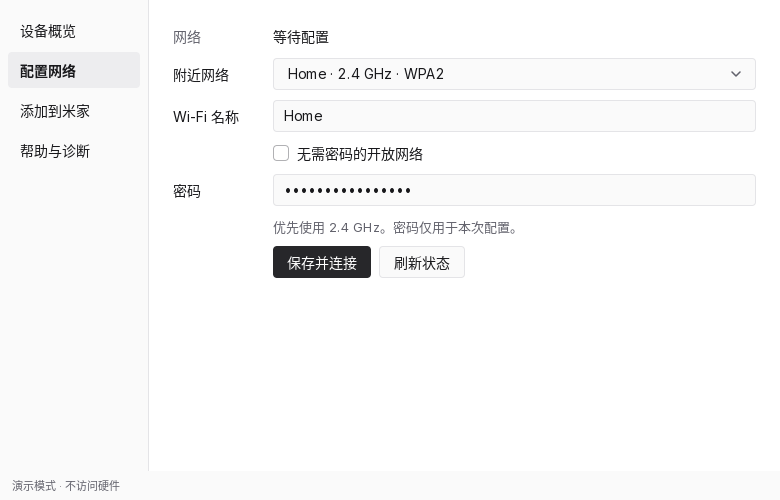

# xiaomi-iot-linux

用于配置小米笔记本内置 IoT 模块的 Linux 桌面工具。配套电脑管家没有 Linux 版本，本项目补充模块查询、Wi-Fi 配网和米家绑定入口。



*配网界面，使用演示数据。*

## 主要功能

- 查看模块型号、固件版本、网络和米家绑定状态。
- 配置模块的 Wi-Fi，重新打开过期的配网窗口。
- 开启米家设备发现，引导手机完成添加并检查绑定结果。
- 检查运行环境、驱动和远程服务状态，导出诊断报告。

另提供[实验性远程关机与睡眠服务](#内核驱动与实验性功能)。

## 支持设备与兼容性

仅适用于带有已启用内置 IoT 模块的以下机型：

| 机型 | 适配与验证状态 |
| --- | --- |
| REDMI Book Pro 16 2026 | 开发机型；原始 Linux 工具已验证配网与绑定 |
| REDMI Book Pro 14 2026 | 已开放兼容，待实机反馈 |
| Xiaomi Book Pro 14（2026） | 已开放兼容，待实机反馈 |

当前 Go 程序及新版驱动仍需实机复测，模拟测试和编译结果不代表完整硬件验证。兼容依据与验证边界见[协议说明](docs/PROTOCOL.md)。

**IoT 配网不限定 BIOS 版本。** 性能模式适配则仅限 TM2425（REDMI Book Pro 16 2026）的 BIOS `RMAPT6B0P0909`。

运行需要 Linux 图形桌面、GTK3、polkit 授权代理和 NetworkManager。**完整安装流程目前主要面向 Arch Linux / mkinitcpio**，远程服务依赖 systemd-logind。其他发行版的运行依赖与安装限制见[开发文档](docs/DEVELOPMENT.md#构建与运行)。

## 安装与运行

以下以 Arch Linux 标准内核为例，先安装依赖：

```sh
sudo pacman -S --needed gtk3 polkit networkmanager kmod dkms make gcc mkinitcpio linux-headers
```

必须安装并保留各目标内核对应的头文件；LTS 内核使用 `linux-lts-headers`。驱动要求 x86_64、Linux 7.2 起，并须通过原始 Bitland 模块的基线校验；较新内核也可能不兼容，见[升级与回退说明](kernel/bitland/README.md#升级边界)。

使用现成分发包时，解压并进入目录后安装；使用源码则先[构建](#从源码构建)：

```sh
sudo ./install.sh
```

安装器会安装应用、Bitland IoT 驱动和远程服务，并重建 initramfs。它不会热卸载驱动、改变模组供电或自动重启；安装成功后请保存工作并自行重启，重启前远程服务保持停止。

重启后，以普通用户从应用菜单启动“小米 IoT 配置助手”，或运行：

```sh
xiaomi-iot
```

硬件操作通过系统 polkit 请求管理员授权。若没有授权窗口，请检查桌面环境的 polkit 授权代理，不要以 root 身份运行图形界面。

卸载时，在分发包或源码目录执行，完成后自行重启以恢复发行版驱动：

```sh
sudo ./uninstall.sh
```

## 米家绑定指南

1. 在“设备概览”点击“读取模块状态”。
2. 在“配置网络”选择或输入 Wi-Fi，填写密码并点击“保存并连接”，等待模块连接小米云。优先使用 2.4 GHz 网络。
3. 若配网窗口已过期，点击“重新打开配网窗口”。此操作需要已加载的 Bitland IoT 驱动，只重启模组，保留米家绑定。
4. 进入“添加到米家”，点击“让米家发现这台电脑”。
5. 手机靠近电脑并开启蓝牙和 WLAN，在米家右上角 `+ → 添加设备 → 扫描附近设备` 完成添加，也可在“办公学习 → 笔记本”手动选择。
6. 手机提示成功后，在应用中点击“检查绑定结果”。

已绑定设备无需重新添加，应用不会重置或解除现有绑定。固件更新（OTA）期间只允许读取状态，不能配网、开启发现或重开配网窗口。

## 内核驱动与实验性功能

项目维护的树外模块 `bitland_mifs_wmi_iot` 通过 DKMS 安装，替代发行版 Bitland 模块加载。它保留上游按键和状态通知，提供重开配网窗口、接收米家电源指令所需的接口，并包含睡眠容错和受限平台的性能模式适配。

远程关机与睡眠仍属实验性功能。首次安装默认 `observe` 模式，只记录电源请求并上报状态；用户配置为 `active` 后才通过 logind 执行操作。安装保留已有模式配置。关机后的远程开机由 IoT 模组和固件处理。

模式设置、启动后检查与已知限制见[远程电源服务](docs/REMOTE.md)；驱动构建、重建和回退见[Bitland 驱动说明](kernel/bitland/README.md)。

## 从源码构建

需要 Go **1.27.2 或更新版本**和 `make`，UI 框架 MyGo 固定为 `v0.5.5`。在项目根目录运行：

```sh
make build
```

构建后按上方步骤安装；单独启动界面不会安装硬件助手或驱动。

无需安装即可检查设备识别结果或查看演示界面：

```sh
./build/xiaomi-iot --detect
./build/xiaomi-iot --demo
```

测试、架构、UI 验证和打包方法见[开发文档](docs/DEVELOPMENT.md)。

## 安全与隐私

特权助手仅接受固定操作，不接受自定义命令、文件路径、内存地址或模块路径。Wi-Fi 密码通过标准输入传给助手，不进入命令行、环境变量或诊断报告，提交后清空界面输入。

应用无需登录小米账号，不保存账号标识，账号绑定由手机米家完成。诊断报告保存到 `~/.local/state/xiaomi-iot-setup/diagnostics.json`，不含密码或账号标识。应用不提供固件刷写或解除绑定功能。

## 相关文档

- [开发与验证](docs/DEVELOPMENT.md)：项目结构、测试、打包和硬件适配。
- [通信协议](docs/PROTOCOL.md)：兼容依据、配网协议与实测边界。
- [Bitland 驱动](kernel/bitland/README.md)：安装、升级、重建与回退。
- [远程电源服务](docs/REMOTE.md)：模式配置、诊断与故障恢复。
- [TM2425 性能模式](docs/TM2425-PROFILES.md)：固件证据、档位映射与适配限制。

## 许可证

应用采用 [MIT](LICENSE)；树外驱动按 GPLv2 分发，见[驱动许可证](kernel/COPYING)和[源码许可说明](kernel/bitland/README.md#源码依据)。第三方依赖遵循各自许可证。

本项目为非官方工具，产品名称及商标归各自权利人所有，仅用于说明兼容性。
